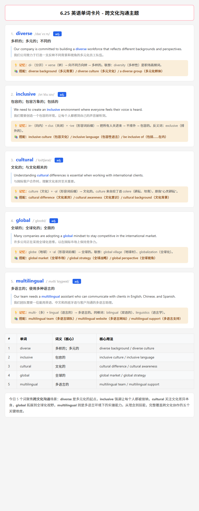

# 每日英语单词 Daily English Words 📚

一个面向 AI Agent 的**主题英语单词学习 Skill**。默认每次推荐 **6 个主题连贯的实用单词**，生成含音标、词义、例句和常用搭配的学习卡片，同时输出汇总表和 HTML 文件。`word-bank.md` 记录已学单词和复习轮次。

> 每次 6 词 · 同一主题 · 可视化卡片

[六词 HTML 示例](examples/2026-08-13-emotional-awareness-self-regulation.html) · [默认六词模板](templates/word-card-template.html) · [执行规则](SKILL.md)

在支持加载 Skill 和读写项目文件的 Agent 中可按需触发。若要每天运行，需在使用的平台配置定时任务。

---

## ✨ 特性

- 📚 **每次默认 6 词**：选择同一主题的实用英语单词，覆盖生活和职场用法
- 🎴 **结构化卡片**：单词 / 音标 / 词性 / 词义 / 例句 / 记忆提示 / 常用搭配，一应俱全
- 📄 **HTML 卡片文件**：自动生成精美 HTML，可直接分享或用于小红书等平台
- 🎨 **9 种卡片风格可选**：`templates/styles/` 内置手账海报、深色词典、大字报、日系极简、索引卡、打字机档案、松林阅读等多套模板，见下方「🎨 卡片风格」
- 🔄 **轮次复习机制**：每轮结束自动生成「上轮单词一览」复习页，温故知新
- 🛡️ **历史去重**：按 `word-bank.md` 避开已学单词。首次运行会初始化词库，格式损坏时先备份再修复。
- 🛡️ **工程化设计**：内置失败模式编码、异常处理表、反例黑名单（详见 SKILL.md）
- ⚙️ **可接入自动化**：可配置为每日定时任务自动执行
- 🧩 **两类模板**：默认使用六词模板，`templates/styles/` 下提供五词模板

## 🖼️ 效果预览

**历史五词模板截图（6 月 25 日，跨文化沟通）**：diverse / inclusive / cultural / global / multilingual

<p align="center">
  <a href="examples/2026-06-25-cross-cultural-communication.html"></a>
</p>

> 📄 完整 HTML 示例见 [examples/](examples/)：

| 示例 | 主题 | 单词 | 推送日期 |
|------|------|------|----------|
| [2026-06-23](examples/2026-06-23-leadership.html) | 领导力 | inspire · empower · mentor · motivate · vision | 2026-06-23 |
| [2026-06-24](examples/2026-06-24-innovative-thinking.html) | 创新思维 | creative · brainstorm · prototype · iterate · experiment | 2026-06-24 |
| [2026-06-25](examples/2026-06-25-cross-cultural-communication.html) | 跨文化沟通 | diverse · inclusive · cultural · global · multilingual | 2026-06-25 |
| [2026-08-13](examples/2026-08-13-emotional-awareness-self-regulation.html) | 情绪识别与自我调节 | overwhelmed · restless · trigger · balance · notice · regulate | 2026-08-13 |

其中 6.23–6.25 是五词模板示例；8.13 是六词模板示例。

## 📦 安装方法

### 方式一：直接把链接丢给 AI Agent（小白最推荐 🌟）

**什么都不用自己操作**，只需把下面这段话复制给你的 AI 助手（WorkBuddy / Codex / Claude 等），让它自己去下载、安装，再教你怎么用：

> 请帮我把这个 GitHub 仓库的 Skill 安装好：
> 仓库：https://github.com/fang-123559/daily-english-words
> 请先下载（git clone 或下载 ZIP），把 `daily-english-words` 文件夹放到我的 skills 目录
> （WorkBuddy: `~/.workbuddy/skills/`，Codex: `~/.codex/skills/`，Claude: `~/.claude/skills/`），
> 确认 `SKILL.md` 在文件夹根目录，然后告诉我怎么用它。

也可以直接让 Agent 执行下面的命令完成下载：

```bash
git clone https://github.com/fang-123559/daily-english-words.git
# 然后按提示把 daily-english-words 文件夹复制到你对应平台的 skills 目录
```

### 方式二：手动下载（推荐新手）

1. 点击右上角 **Code → Download ZIP** 下载并解压
2. 将解压后的文件夹放入你的 Skill 目录：
   - **WorkBuddy**：`~/.workbuddy/skills/`
   - **Codex**：`~/.codex/skills/`
   - **Claude**：`~/.claude/skills/`
   - 其他支持 Agent Skills 的平台：放入对应 skills 目录
3. 确保文件夹名为 `daily-english-words`，且 `SKILL.md` 在文件夹根目录

### 方式三：Git 克隆

```bash
git clone https://github.com/fang-123559/daily-english-words.git
# 然后将整个文件夹复制到 skills 目录
```

## 🚀 使用方式

### 方式一：对话中直接触发

安装完成后，在 AI 对话中输入任意触发词，即可生成今日单词卡片：

> "每日英语单词"、"推荐6个英语单词"、"今天学什么单词"

### 方式二：接入自动化定时推送（推荐）

在 WorkBuddy / Codex / Claude 等平台创建一个每日定时任务，prompt 可参考 [prompts/automation-prompt.md](prompts/automation-prompt.md)：

```text
默认每天推荐 6 个英语单词，严格按 SKILL.md 的 daily-english-words 模板执行：
读取 word-bank.md 词库去重 → 判断轮次 → 选 6 个主题连贯的新词 → 输出卡片+表格+HTML → 更新词库

如果明确指定 `templates/styles/` 下的模板，则使用五词模板，保留对应模板结构。
```

首次使用请复制 [templates/word-bank-template.md](templates/word-bank-template.md) 为项目根目录下的 `word-bank.md`。

## 🎨 卡片风格

HTML 卡片支持多套风格模板，使用时告诉 AI 你想要的风格名即可（如「今天用深色词典风格」），不指定则用默认经典模板：

| 风格 | 模板文件 | 特点 |
|------|----------|------|
| 经典文档（六词模板，默认） | [word-card-template.html](templates/word-card-template.html) | V3 六词 + 米白橄榄绿，简洁通用 |
| 手账海报 | [journal-poster.html](templates/styles/journal-poster.html) | 竖版小红书海报，胶带贴卡、日期印章 |
| 精修文档 | [refined-doc.html](templates/styles/refined-doc.html) | 经典版的统一配色升级款 |
| 深色词典 | [dark-lexicon.html](templates/styles/dark-lexicon.html) | 深墨蓝底 + 金色点缀，词典式排版 |
| 大字报 | [editorial-bulletin.html](templates/styles/editorial-bulletin.html) | 黑粗边框 + 荧光黄高亮，报刊公报感 |
| 日系极简 | [muji-minimal.html](templates/styles/muji-minimal.html) | 大量留白、发丝分隔线 |
| 索引卡 | [index-flashcard.html](templates/styles/index-flashcard.html) | 横线活页卡 + 分类标签 + 手写体 |
| 打字机档案 | [typewriter-archive.html](templates/styles/typewriter-archive.html) | 牛皮纸档案袋 + 等宽字体 + 印章 |
| 松林阅读 | [pine-app.html](templates/styles/pine-app.html) | 深松绿底 + 奶油实卡，阅读 APP 质感 |

> 直接点开对应模板文件即可预览效果；也可以让 AI「把今天和昨天的卡片都换成 XX 风格」重新生成。

## 🗂️ 项目结构

```
daily-english-words/
├── SKILL.md                      # Skill 核心定义（执行流程 + 模板规范 + 异常处理）
├── README.md                     # 本文件
├── LICENSE                       # MIT 许可证
├── prompts/
│   └── automation-prompt.md      # 自动化定时任务的 prompt 模板
├── templates/
│   ├── word-bank-template.md     # word-bank.md 词库模板（去重用）
│   ├── word-card-template.html   # 六词模板（V3）
│   └── styles/                   # 五词模板
└── examples/                     # 五词与六词模板的完整输出示例
```

## ⚙️ 自定义

- **换风格**：对话中直接说「用 XX 风格」，AI 会改用 `templates/styles/` 下对应模板
- **改配色**：默认 V3 模板使用 CSS 变量控制米白、白色、橄榄绿和柔和浅灰；其他风格直接改对应模板文件的 CSS 变量
- **加风格**：仿照 `templates/styles/` 下现有模板新增 HTML 文件，并在 SKILL.md 的风格一览表中登记
- **改推送风格**：六词模板与五词模板分开维护，避免改变既有模板结构
- **改触发场景**：修改 SKILL.md frontmatter 中的 `description` 触发词

## 📜 License

[MIT](LICENSE) © fang-123559

---

<p align="center"><b>每天 6 个词 · 让英语融入生活</b> 🇬🇧</p>
